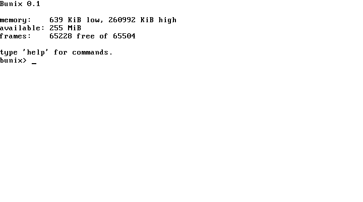

# Bunix

An independent operating system written in Hare. The kernel exposes its own
small set of system calls and reaches resources through file servers rather
than imitating POSIX; POSIX software is served later by a userspace port
environment, not by the kernel. Bunix is not a clone of any existing system.
Some ideas in its design trace back to earlier file-oriented systems, but it
shares no code and no protocol with them.

The kernel currently targets x86_64 and boots as a Multiboot image.

## Building

The tree is built entirely with the Hare toolchain; there is no C in the
kernel. It expects `hare`, `harec`, `qbe`, `as`, and `ld` on `PATH`.

	make

The result is a Multiboot ELF named `bunix`.

## Running

	qemu-system-x86_64 -m 256 -kernel bunix -serial stdio

or `make run`. The kernel writes its boot log to both the VGA text console and
COM1.

## Layout

| Path        | Contents                                        |
|-------------|-------------------------------------------------|
| `rt/`       | Freestanding Hare runtime: entry, memory ops, heap |
| `debug/`    | Placeholder module the build driver expects     |
| `arch/`     | x86_64 CPU, port, interrupt, PIC, timer code    |
| `boot/`     | Multiboot information parsing                   |
| `mem/`      | Physical frame allocator                        |
| `bfp/`      | Bunix File Protocol: wire format, server, client |
| `sys/`      | System name and version                         |
| `console/`  | Serial, VGA text, and keyboard                  |
| `shell/`    | Console command loop                            |
| `main.ha`   | Kernel entry point                              |

## Status

The kernel enters long mode, brings up the serial and VGA consoles, reads the
Multiboot memory map, manages physical frames with a bitmap, and runs a
PIT-driven clock behind an interrupt descriptor table. A small command loop is
available on the console:

	bfp clear echo fault frames halt heap help mem uptime version

The `bfp` command runs a full proto/attach/walk/open/read/clunk exchange against
an in-memory file server, so the Bunix File Protocol is exercised end to end.
The `heap` command builds a string with `append`, which drives the runtime
allocator the compiler lowers the built-ins to.

There are no processes and no filesystem yet. See `DESIGN.md` for where it is
going.
