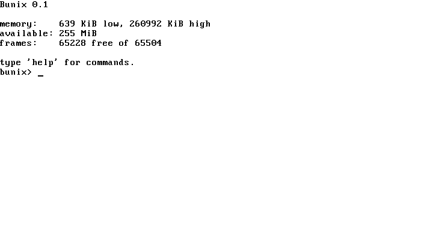
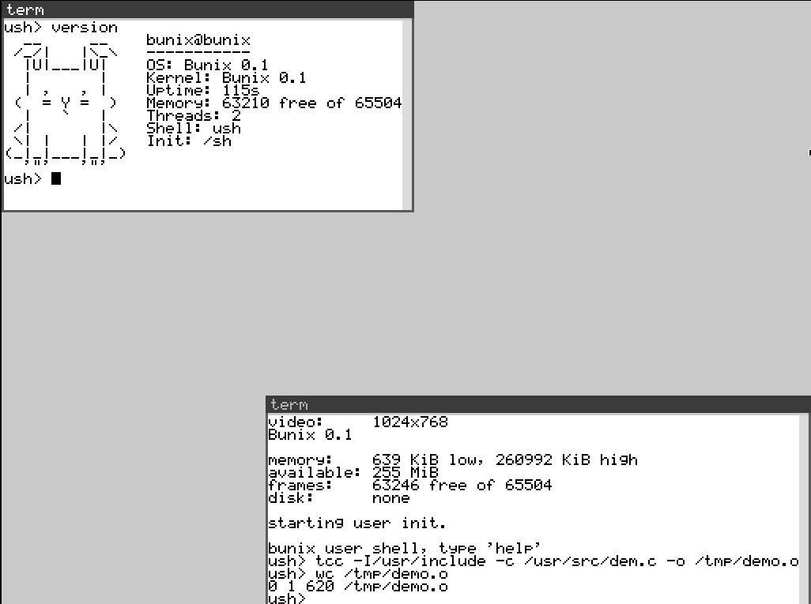
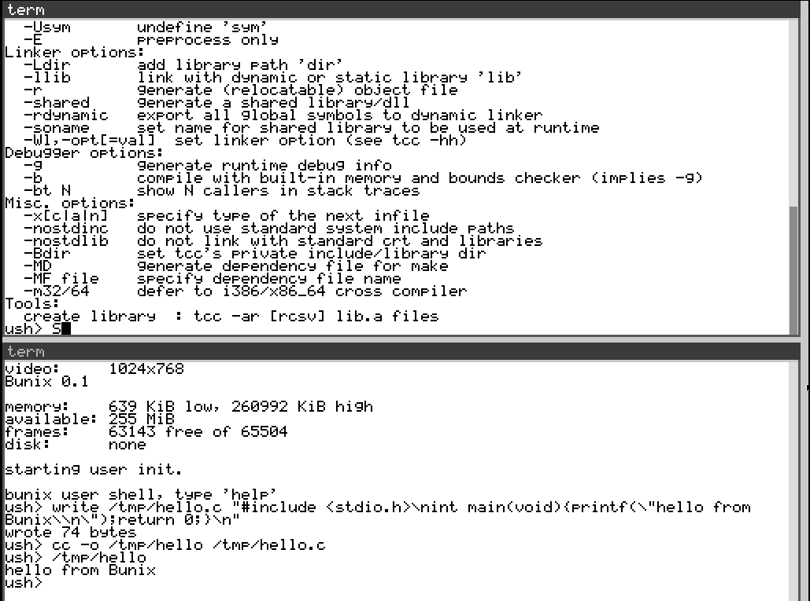
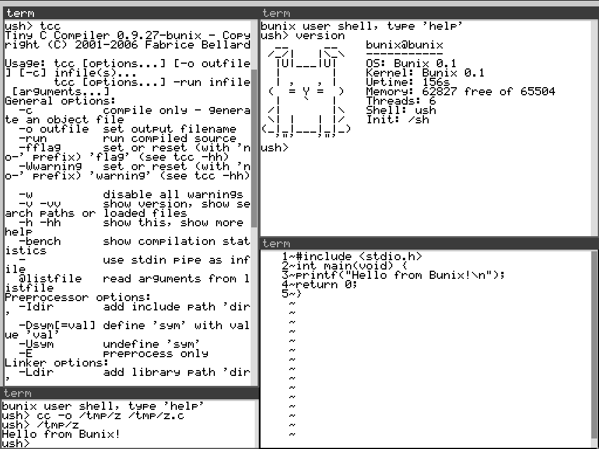
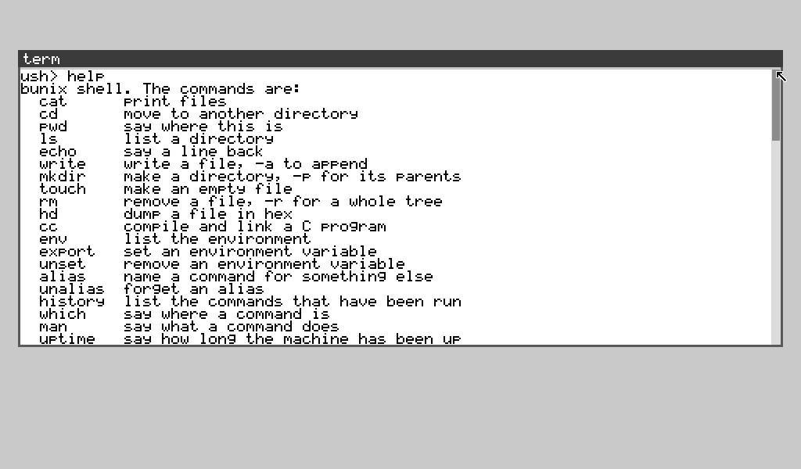
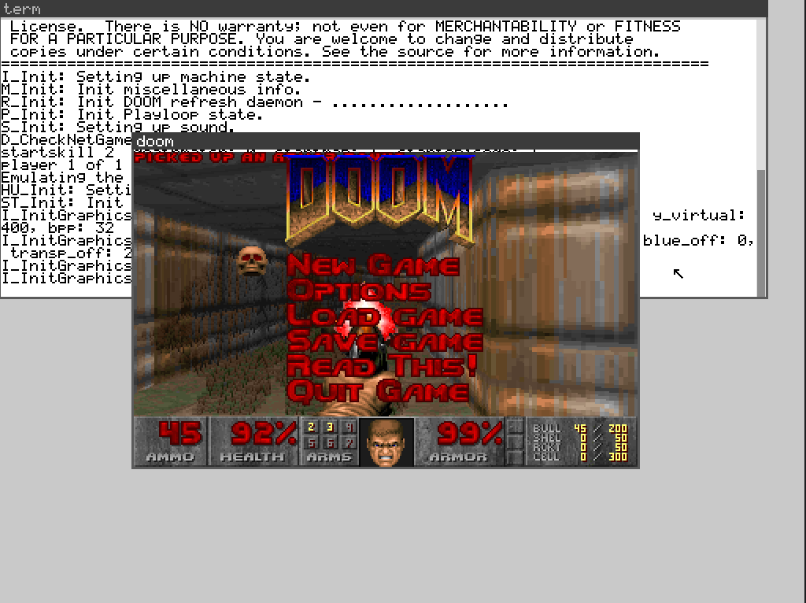

# Bunix-Bunny's Unix

An operating system written in Hare. It comes with a C compiler and a text
editor, and both of them run inside Bunix kernel/os.

It boots into a small window manager Kit.

tcc is part of the system.

	ush> write /tmp/hello.c "#include <stdio.h>\nint main(void){printf(\"hello from Bunix\\n\");return 0;}\n"
	wrote 74 bytes
	ush> cc -o /tmp/hello /tmp/hello.c
	ush> /tmp/hello
	hello from Bunix

`mei` is an editor that draws straight onto the console.I tryed to keep it simple as i can for now. 

Some of what the shell knows:

## The shell

The shell `ush` is the one you land in. It keeps a working directory, a
history and a few aliases, and the arrow keys walk the history (As usual) .

	ush> cd /usr/include
	ush> ls stdio.h
	stdio.h
	ush> pwd
	/usr/include
	ush> alias ll="ls -l"
	ush> ll /bin
	hello                       12392
	wc                          21552
	ush> history
	1  cd /usr/include
	2  ls stdio.h

The commands of the shell itself are `cat`, `cd`, `pwd`, `echo`, `write`,
`mkdir`, `touch`, `rm`, `hd`, `cc`, `env`, `export`, `unset`, `alias`,
`unalias`, `history`, `which`, `type`, `man`, `uptime`, `free`, `sleep`,
`clear`, `true`, `false`, `pushd`, `popd`, `user`, `multi`, `version`,
`help`, `tutorial`, `halt`, `poweroff` and `exit`.

The programs with an image of their own are found through `/bin` and are run
by name: `ls`, `sort`, `uniq`, `head`, `tail`, `tr`, `rev`, `seq`, `expr`,
`basename`, `dirname`, `stat`, `du`, `df`, `test`, `find`, `tree`, `grep`,
`wc`, `cp`, `mv`, `nl`, `cut`, `paste`, `comm`, `diff`, `od`, `strings`,
`cksum`, `file`, `uname`, `id`, `split`, `ps`, `kill`, `install`, `hello`,
`cc`, `tcc`, `test_c` and `mei`.

A name with a `*` in it is looked for, so a command that takes paths can be
given a pattern:

	ush> cd /usr/include
	ush> ls std*.h
	stdalign.h
	stdarg.h
	stdbool.h
	...

The output of a command can be sent to a file, with `>` to start the file
over and with `>>` to add to what is already in it:

	ush> ls /usr/include > /tmp/list
	ush> wc -l /tmp/list
	44 /tmp/list

A word can be in quotes, so a name with a space in it stays one word:

	ush> write "/tmp/with space.txt" "a line\n"
	ush> cat "/tmp/with space.txt"
	a line

Also a pipe is a file too. The command on the left writes to `/dev/pipe0`, and the one on the right is given that file:

	ush> cat /tmp/list | sort
	ush> cat /tmp/list | grep -n std | head -3
	1	stdalign.h
	2	stdarg.h
	3	stdbool.h
	ush> cat /tmp/list | sort > /tmp/sorted

The two commands do not run at once — the left one finishes before the right
one starts — but the file is real, and the commands that take a path work
through it. (Gone Improve It) 

The filters take the small flags: `sort -n -r -u`, `grep -i -v -n -c`,
`wc -l -w -c`, `comm -1 -2 -3`, `head -5`, `tail -n 5`, `cp -r`, `tr a-z A-Z`.

## The tutorial

`tutorial` walks through the system, a page at a time. It opens on a contents
page:

	ush> tutorial
	Bunix tutorial

	Bunix is a small Unix. It starts one program, the shell, and the
	shell is where you work. The one idea to keep is that everything
	you can name is a file: a directory, the disk, the kernel, the
	memory, even a pipe.

	Read a chapter with
	  tutorial 1    where you are
	  tutorial 2    files and directories
	  tutorial 3    finding things
	  tutorial 4    files that are not files
	  tutorial 5    programs and the machine
	  tutorial all  all five

	man <command> says what one command does.

	ush> cat /proc/mem      the memory
	ush> cat /proc/uptime   seconds since it started
	ush> hd /dev/bootsec    the boot sector, in hex

`tutorial all` prints all five in one go. Anything but a number from 1 to 5
says what it takes:

	ush> tutorial 9
	usage: tutorial [1-5|all]

## Installing on a disk

Bunix can put itself on a disk. Give the machine a disk and run `install`:

	ush> install
	Bunix installer.

	The disk has 131072 sectors of 512 bytes.
	The kernel is 1369472 bytes, which is 2675 sectors.

	The disk will be made like this:
	  the kernel, at sector 2048
	  the filesystem, at sector 6144

	Write to the disk? (yes/no) yes
	Writing the boot sector... done.
	Writing the second stage... done.
	Writing the kernel... done.

	Bunix is on the disk. Take it out, put it in the machine
	you want, and start it from the disk.

Nothing is written until the answer is yes, and answering no leaves the disk
as it was. The installer asks no questions that it does not need answered,
because everything it needs is a file: the boot sector is `/dev/bootsec`, the
second stage is `/dev/stage2`, and the kernel is `/dev/kernel`.

After that the disk boots on its own:

	qemu-system-x86_64 -m 256 -drive file=disk.img,format=raw,if=ide -boot c \
		-serial stdio

The boot sector hands the memory map to the kernel in the multiboot form, so
the kernel does not care whether it was started by a multiboot loader or by
the boot sector: it reads the same map either way.

## Build
Needs `hare`, `qbe`, `as` and `ld` on your PATH.

	make

That leaves you a `bunix.bin`.

## Run

	/usr/bin/qemu-system-x86_64 -m 256 -kernel bunix.bin -display gtk -serial stdio

or just `make run`, which opens a graphical window and sends the machine's
sound to the host's speakers. The screen is drawn on the framebuffer; the
serial line carries the same text. `make run-nographic` is the same machine
with no window, for when there is no display.

`make` uses `/usr/bin/qemu-system-x86_64` on purpose: the copy in
`~/.local/bin` was built with only the `none` display and `wav` audio backends,
so it cannot open a window or play through the speakers. If your system QEMU
lives elsewhere, set `QEMU` in `config.mk`.

Type `help` to see what the shell knows, and `tutorial` for a walk through
the system, a page at a time. `man <command>` says what one command does.

## When things break

A bad address in a program is no big deal: that program is killed and the
desktop carries on. If the kernel itself faults, there's nothing safe left to
do, so it stops. The screen goes white with a few black words: `BUNIX PANIC`
and the reason. The same words go out on the serial line for anyone who isn't
looking at the display. Reboot to get back.

You can try it without breaking anything important:

	ush> panic

shows the screen with a reason, and

	ush> fault

causes a real page fault, so the reason reads `kernel fault`. Both stop the
machine, so only run them when you're ready to reboot. Ordinary programs
can't call these by accident: the kernel needs a magic word with the call.

To give the machine a disk, add one to QEMU and it is mounted at `/mnt`:

	qemu-system-x86_64 -m 256 -kernel bunix.bin -serial stdio \
		-drive file=disk.img,format=raw,if=ide

The disk is a file, so a copy of it is a copy of everything on it.

## Sound

Bunix has sound now. The card is just a file, like the screen and the
keyboard: write PCM to `/dev/audio` and it plays, read `/dev/audioctl` to see
the format, write to it to change things, and `cat /proc/audio` to find out
what hardware was found. There's no special sound syscall and nothing extra
to link — if your program can write a file, it can make a noise.

Have a listen:

	ush> cat /proc/audio
	sb16 base 544 irq 5 dma 1 5 blocks 0 irqs 0 queued 0 volume 100
	ush> tone
	tone: played 440 Hz for a second

`tone` is a tiny program that writes a sine wave to `/dev/audio`. `vol` is the
volume knob for the whole machine:

	ush> vol
	volume 100
	ush> vol 40
	volume 40

`vol 0` mutes everything and `vol 100` is full blast. It belongs to the
machine, not to one song, so it stays where you put it when the format changes
or another program starts playing. The kernel turns samples down on their way
to the card, which means it works for every program that writes to the audio
file — Doom included.

Under the hood there's a Sound Blaster 16, driven with ISA DMA and an
interrupt so the sound keeps going between writes. `/dev/audioctl` keeps its
settings on one short line, `rate channels bits volume`; writing `stop` there
shuts the card up. Everything a port needs is in `dev.h` as ordinary read and
write helpers, so the next game you add gets sound without inventing its own
way of talking to the hardware.

`make run` gives QEMU a sound card and hooks it up to your speakers
(PulseAudio). If you'd rather look at the bytes than listen to them,
`make run-wav` records what the card plays into `/tmp/bunix.wav`. And if the
machine has no card at all, the sound files simply answer with nothing while
everything else carries on as usual.

## DOOM

DOOM runs on Bunix as a plain user-space program. The first build downloads the
shareware data file into `build/doom1.wad` and embeds it in the kernel; this
requires `curl` and an internet connection on the host. The downloaded file is
reused on later builds unless `make clean` removes it. Controls are keyboard
only.

	ush> cd /Doom
	ush> ls
	doom1.wad  doom
	ush> doom

`/Doom/doom` works from anywhere too. Everything is a file: the window is
`/dev/win`, the keys arrive on `/dev/kbd`, the framebuffer it draws on is
`/dev/fb`, and the sound effects are written to `/dev/audio` — DOOM is just a
program reading and writing files. The game mixes its own samples against the
clock it runs on, so a shot is heard when it happens. Music is still quiet,
sorry: those lumps are MIDI for an OPL chip, not samples. When you quit from
the game's menu the process really ends and you get your `ush>` back; deleting
the game's window from the desktop menu does the same, so nothing is left
playing or eating CPU in the background.

Controls, keyboard only:

	Arrows        move / turn
	Shift         run
	Ctrl          fire
	Alt (hold)    strafe with the arrows
	, and .       strafe left / right
	Space         use (open doors, press switches)
	Tab           map
	1 - 7         weapons
	Esc           menu
	F1 - F9       help, ammo, health, keys, ... (DOOM's own screens)

## Fun

Right now Bunix have mascot calling "BunBun the Hare". 

## Lisencing 

GPL 3 lisence

