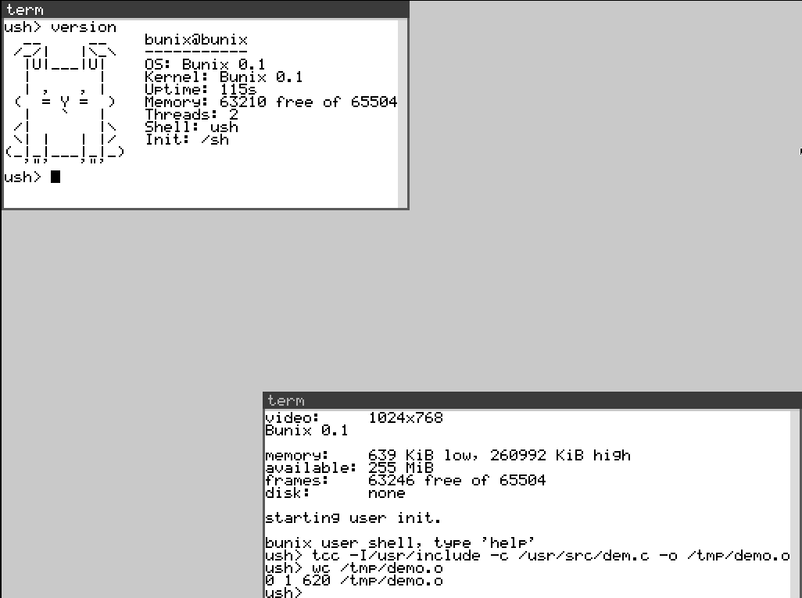
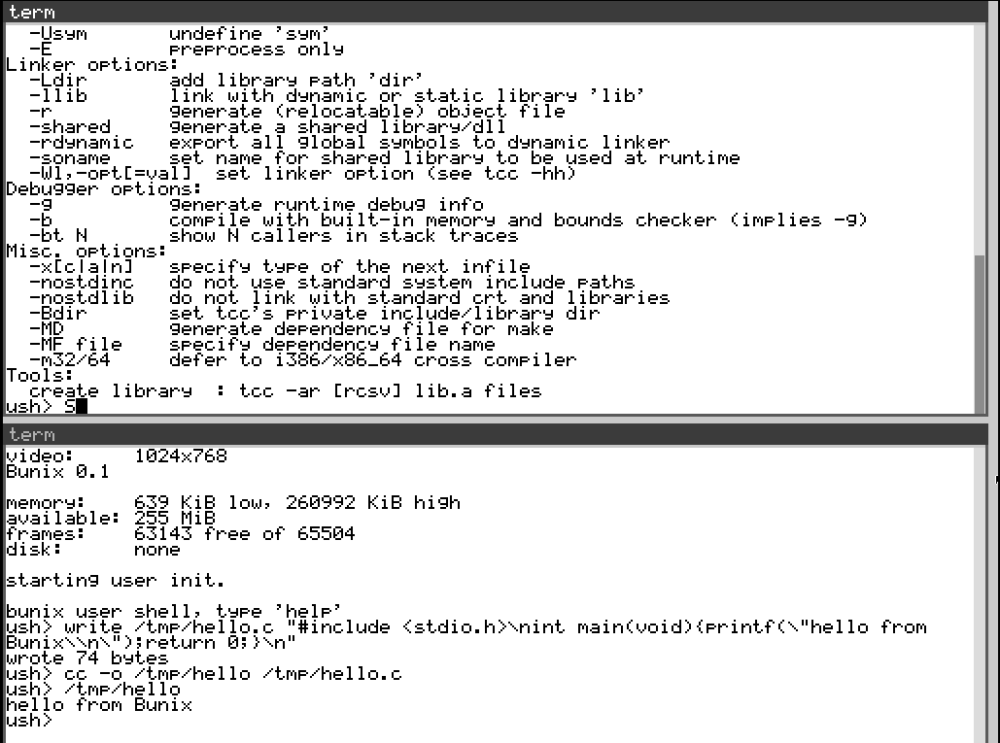
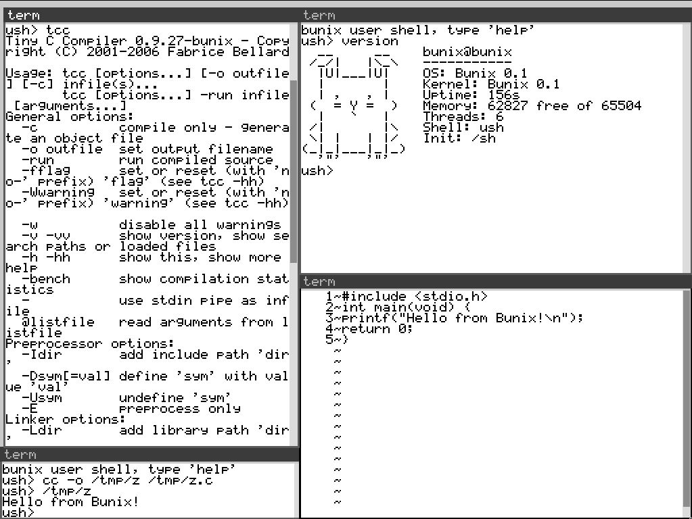
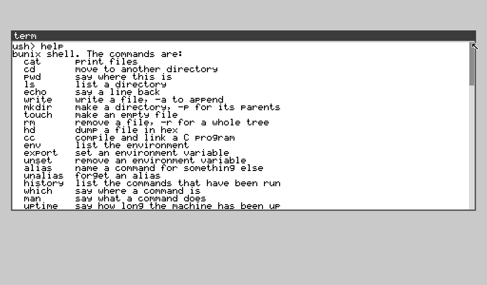

# Bunix

An operating system written in Hare. It comes with a C compiler and a text
editor, and both of them run inside Bunix kernel/os.

It boots into a small window manager Kit.

tcc is part of the system. Write some C, compile it, run it, without leaving.

	ush> write /tmp/hello.c "#include <stdio.h>\nint main(void){printf(\"hello from Bunix\\n\");return 0;}\n"
	wrote 74 bytes
	ush> cc -o /tmp/hello /tmp/hello.c
	ush> /tmp/hello
	hello from Bunix

There is also `mei`, an editor that draws straight onto the console. Arrows,
Home, End, Ctrl-S to save, Ctrl-X to save and quit.I tryed to keep it simple as i can for now. 

Some of what the shell knows:

## Build
Needs `hare`, `qbe`, `as` and `ld` on your PATH.

	make

That leaves you a `bunix.bin`.

## Run

	qemu-system-x86_64 -m 256 -kernel bunix.bin -serial stdio

or just `make run`. The screen you get is drawn on the framebuffer; the serial
line carries the same text.

Type `help` to see what the shell knows.
